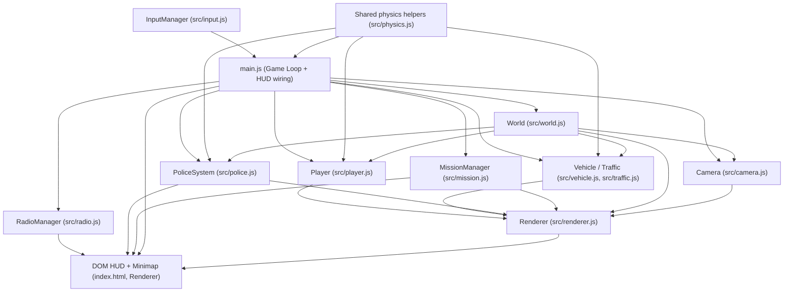

# Mini GTA 6 Architecture

Mini GTA 6 is built with vanilla ES modules and HTML5 Canvas, structured as decoupled simulation, input, audio, camera, and rendering layers orchestrated by `src/main.js`. Every module except `main.js`, `input.js`, and `renderer.js` is DOM-free and unit-tested headlessly in Node.

## System Diagram

## Module Responsibilities

| Module | Owns | DOM-free / tested |
|---|---|---|
| `input.js` | Keyboard state, single-press consumption, normalized move/drive intent | no (window listeners) |
| `physics.js` | `lerpAngle`, iterative circle-vs-AABB push-out, free-spot probe, world clamp, `clampFrameDt` | ✅ |
| `world.js` | Map size, roads, buildings (with walkable `ALLEY_WIDTH` alleys), beach/ocean, colliders, districts | ✅ |
| `player.js` | On-foot movement, stride animation, collisions vs buildings and parked cars (OBB) | ✅ |
| `vehicle.js` | Driving physics, drift, collisions, safe exit, traffic AI, coasting for abandoned cars, `enterByPlayer` / `exitByPlayer` | ✅ |
| `traffic.js` | Initial parked cars (on curbs, `CURB_OFFSET`) and clockwise right-lane traffic loops | ✅ |
| `police.js` | Wanted level (0–5★), heat debounce, police spawn/chase, 8s escape cooldown, 2s BUSTED | ✅ |
| `mission.js` | Timed delivery/getaway jobs, start/target zones, `+$500` reward, cash | ✅ |
| `radio.js` | Station cycling, Web Audio synth beat, pause/suspend | ✅ (no-op headless) |
| `camera.js` | Smooth follow camera clamped to the world | ✅ |
| `renderer.js` | Draws world, entities, mission marker/arrow, police lights, minimap (read-only) | no (Canvas) |
| `main.js` | Game loop, mode switching, pause/reset/busted, HiDPI canvas sizing, HUD updates | no (DOM) |

## Per-Frame Data Flow

1. **Timing**: `dt = clampFrameDt(rawDt)` caps every step at `0.05s` so tab switches or hitches never tunnel cars through walls.
2. **Input Capture (`InputManager`)**: `main.js` consumes single-press actions (`P` pause, `R` radio, `Shift+R` reset, `E`/`F` enter/exit) and reads continuous movement or driving intent for the active mode.
3. **Simulation Update**:
   - **On foot**: `Player.update(dt, moveInput, world, vehicles)` applies walk/run velocity, then resolves collisions vs parked cars (circle-vs-OBB) and buildings (iterative circle-vs-AABB).
   - **Driving**: `activeVehicle.updatePlayerDriven(dt, driveInput, world, vehicles)` updates throttle, braking/reverse, velocity-scaled steering, drift, and collision bounce. Hitting another car adds heat.
   - **Unoccupied vehicles**: `car.updateTraffic(...)`. Traffic cars follow waypoint loops and yield to obstacles within `65px` ahead; parked or abandoned cars coast to a stop.
   - **Police**: `police.update(dt, focus, speed, world, vehicles)` handles speeding detection, chase AI, the escape cooldown, and BUSTED progress.
   - **Missions**: `mission.update(dt, focus)` handles start-zone triggers, the countdown, and the reward.
4. **Camera & Audio**: `Camera.update(focusTarget, dt)` tracks the player or `activeVehicle`. `RadioManager` keeps the station state and suspends audio while paused or hidden.
5. **Rendering & HUD**: `Renderer` draws everything from read-only state at device-pixel resolution. `main.js` updates the HUD labels (wanted stars and cooldown, cash, mission status, district, mode, MPH, radio).
